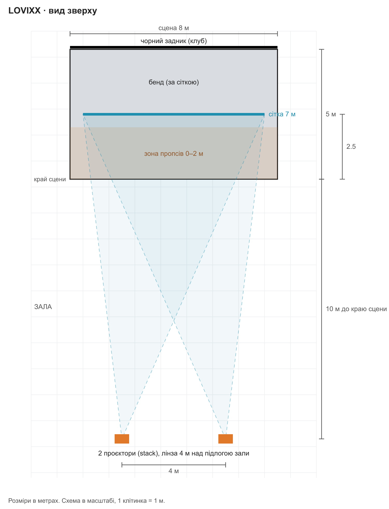
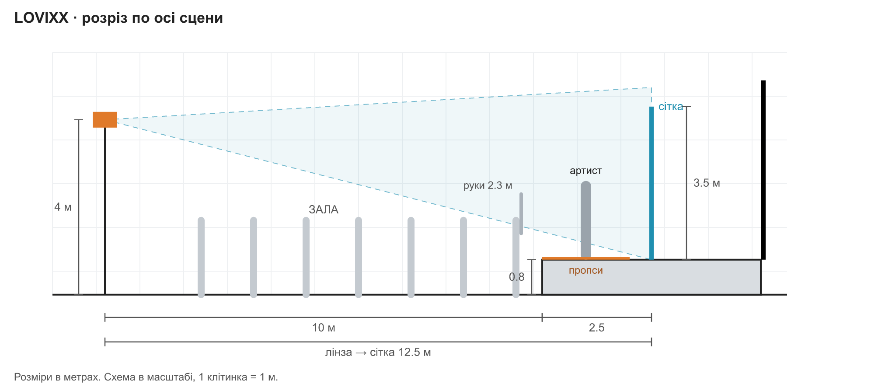

# LOVIXX live — технічний райдер (проєкція і сценографія)

Шоу: LOVIXX + 2 MC + живий бенд (ударні, синт, бас). Проєкція на прозору сітку перед бендом і на пропси на авансцені.
Звук, бекланй і гостьовий райдер — окремі документи **[уточнити]**.

Позначка **[уточнити]** — пункт ще не визначений з нашого боку.

---

## 1. Контакти

| роль | ім'я | телефон |
|---|---|---|
| Менеджмент | [уточнити] | [уточнити] |
| Проєкція, мапінг (Юрій) | Юрій | [уточнити] |
| Технічний менеджер туру | [уточнити] | [уточнити] |

Анкету майданчика просимо повернути заповненою за 2 тижні до шоу.

## 2. Що надає клуб

**Сцена**
- Сцена розрахована на 8.0 × 5.0 м. Менші розміри — за погодженням.
- Вільна висота над сценою: не менше 4 м.
- Позиція для сітки 2.0–3.0 м від переднього краю сцени. Штанкет у цій зоні або дозвіл поставити наші стійки на сцену.
- Точки кріплення бічних розтяжок по краях сцени.
- **Чорний задник** (мольтон) на всю ширину сцени. Обов'язково: на світлому тлі проєкція на сітці не працює.

**Позиція проєкторів**
- Місце для двох проєкторів на осі сцени, 5.9–11.5 м від переднього краю сцени (при сітці 2.5 м від краю), лінза на висоті 3.5–4 м над підлогою зали. Розведення між проєкторами — 4 м.
- Варіанти: дві наші стійки біля FOH з огородженням / балкон (5–7 м) / ферма над залою (4–6 м).
- Між проєкторами і сценою під час шоу немає конструкцій і підвісного обладнання на висоті променя.

**Світло**
- Світлова система клубу і світлотехнік на шоу.
- Можливість повністю вимкнути фронтальну заливку сцени в зоні сітки і загальне світло зали.
- Бічні позиції для світла на артистів.

**Інше**
- Живлення: 1 лінія 220 В / 16 А біля позиції проєкторів.
- Доступ на сцену не менше ніж за 3.5 год до відкриття дверей.

## 3. Що везе команда

- 2 лазерні проєктори 5000–6000 ANSI лм, зум-лінза, vertical lens shift **[модель уточнити]**.
- 2 стійки під проєктори, висота лінзи до 4 м **[модель, вага уточнити]**.
- Сітка 7.0 × 3.5 м (темно-сірий sharkstooth / hologauze, вогнетривка обробка), нижня труба-обважнювач, бічні розтяжки.
- Стійки pipe & drape для сітки (якщо в клубу немає штанкета в потрібній зоні).
- Пропси для авансцени **[склад і розміри уточнити]**.
- 2 ноутбуки з шоу (основний і резервний).
- Кабелі сигналу: HDMI 2.0 до 10 м або HDBaseT для довших трас.
- Хейзер **[чий — наш чи клубу, уточнити]**.

## 4. Схема сцени

Схеми в масштабі для базового варіанту: сітка 2.5 м від краю сцени, проєктори 10 м від краю, лінза 4 м.

**Вид зверху**

**Розріз по осі сцени**

Розташування шарів від залу:
1. **Пропси** — зона 0–2 м від краю сцени.
2. **Сітка** 7.0 × 3.5 м — 2.0–3.0 м від краю (база 2.5 м), від рівня сцени вгору, натягнута.
3. **Бенд** за сіткою.
4. **Чорний задник.**

Артисти (LOVIXX і 2 MC) — перед сіткою.

3D-превізуалізація (візуалізація концепції): https://lovixx-previz.vercel.app

## 5. Світло і хейзер

- **Без фронтальної заливки в зону сітки.** Світло засвічує сітку і вбиває контраст проєкції.
- Артисти — бічним світлом під крутим кутом (45° і більше).
- Бенд за сіткою — контровим / верхнім світлом.
- Загальне світло зали на час шоу вимкнене. Аварійне освітлення не чіпаємо.
- Хейзер водний, легкий. Режим погоджується з клубом з урахуванням пожежних датчиків. Якщо хейзер заборонений — шоу без змін.

## 6. Живлення і сигнал

- **Живлення:** 1 лінія 220 В / 16 А біля позиції проєкторів.
- **Сигнал:** ноутбук з шоу біля FOH → проєктори. До 10 м — HDMI 2.0, балкон або довші траси — HDBaseT.
- **Резерв:** другий ноутбук з тим самим шоу, перемикання на місці.
- **Синхронізація:** MIDI clock / Ableton Link від плейбеку, якщо бенд грає під клік; інакше вручну **[уточнити з бендом]**.

## 7. Таймінг

Доступ на сцену — не менше ніж за 3.5 год до відкриття дверей.

| від початку | що |
|---|---|
| 0:00–0:45 | монтаж сітки |
| 0:45–1:15 | проєктори і сигнал |
| 1:15–2:15 | пропси за розміткою, суміщення двох проєкторів |
| 2:15–3:00 | прогін зі світлом |
| 3:00–3:30 | резерв |

На час суміщення проєкторів (1:15–2:15) потрібна темна зала і вимкнене світло на сцені.

## 8. План Б

| ситуація | рішення |
|---|---|
| немає місця під сітку (глибина, висота, підвіс) | пропси + проєкція на чорний задник або LED-екран клубу |
| немає позиції для лінзи на 3.5 м і вище | стійки на максимум, графіка у верхній половині сітки |
| відмовив проєктор | шоу на одному проєкторі |
| хейзер заборонено | шоу без змін |
